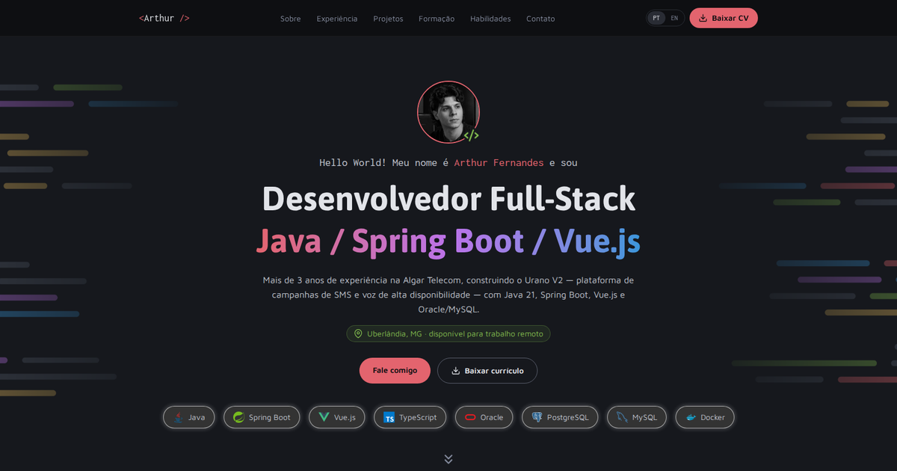

# Arthur Fernandes — Portfolio

<p align="center">
  Bilingual (PT/EN) personal website with my experience, projects, education and
  skills, all in line with my resume.
</p>

<p align="center">
  <a href="https://artfrc.github.io/Meu-portfolio/"></a>
  
  
  
</p>

<p align="center">
  <a href="#-about">About</a> ·
  <a href="#-tech-stack">Tech stack</a> ·
  <a href="#-project-structure">Structure</a> ·
  <a href="#-updating-the-content">Updating the content</a> ·
  <a href="#-running-locally">Running locally</a> ·
  <a href="#-deployment">Deployment</a> ·
  <a href="#-contact">Contact</a>
</p>

<br>

<p align="center">
  
</p>

## 🧭 About

Portfolio published on [GitHub Pages](https://artfrc.github.io/Meu-portfolio/), featuring:

- Professional summary, experience, projects, education and technical skills,
  mirroring my resume
- Portuguese and English versions: a language switcher at the top, and adding
  `?lang=en` to the link opens the site straight in English
- A button to download my resume as a PDF in the selected language
- Contact via LinkedIn, GitHub, WhatsApp and email

## 🚀 Tech stack

- Vue 3 (Composition API) + TypeScript + Vite
- Tailwind CSS 4, keeping the color palette and fonts from the previous version of
  the site
- Typed content in PT and EN (`src/content/`)
- Tests with Vitest + Vue Test Utils
- GitHub Actions: tests, builds and deploys to GitHub Pages on every push to `main`

## 📁 Project structure

```
.
├── index.html                 Vite entry point (meta tags, fonts)
├── src/
│   ├── content/               Site copy: pt.ts, en.ts and shared.ts
│   ├── components/            Page sections (hero, about, experience, projects...)
│   ├── composables/           Language (useLocale) and active menu item
│   └── assets/                Images, backgrounds and icons
├── public/
│   ├── cv/                    Resume PDFs (PT and EN) behind the "Download resume" button
│   └── preview.png            Link preview image (social networks and this README)
└── .github/workflows/         GitHub Pages deployment
```

## 📝 Updating the content

All the site copy lives in [`src/content/`](src/content/):

- `pt.ts` and `en.ts`: the text for each language. TypeScript won't let either
  version miss a field, and `npm test` checks that both have the same structure
  (same number of jobs, bullet points, projects...)
- `shared.ts`: everything that doesn't change with the language, such as links,
  tech stacks, images and the PDF file names

To update the resume, replace the PDFs in [`public/cv/`](public/cv/), keeping the
same file names.

## 💻 Running locally

Requirement: Node.js 22.12+.

```bash
npm install
npm run dev      # http://localhost:5500/Meu-portfolio/
npm test         # tests (Vitest)
npm run build    # type-check + production build in dist/
```

No Node on your machine? You can run it with Docker (`node_modules` lives in a volume,
outside the project folder). `CHOKIDAR_USEPOLLING` makes the page update when you
save a file on Windows, where Docker doesn't forward file events to the container:

```bash
docker run --rm -it -p 5500:5500 -e CHOKIDAR_USEPOLLING=true -v "${PWD}:/app" -v portfolio_node_modules:/app/node_modules -w /app node:24-slim sh -c "npm install && npm run dev -- --host"
```

## 🌐 Deployment

The [`.github/workflows/deploy.yml`](.github/workflows/deploy.yml) workflow runs the
tests, builds the site and publishes it to
[GitHub Pages](https://artfrc.github.io/Meu-portfolio/) on every push to `main`.

> **One-time GitHub setup:** under *Settings → Pages → Build and deployment*,
> *Source* must be set to **GitHub Actions** (not *Deploy from a branch*).
> Otherwise, Pages publishes the source code instead of the built site.

## 📬 Contact

- [LinkedIn](https://www.linkedin.com/in/fernandes-arthur/)
- [GitHub](https://github.com/artfrc)
- Or through the [contact section of the website](https://artfrc.github.io/Meu-portfolio/#contato)
  (email and WhatsApp are listed there)
