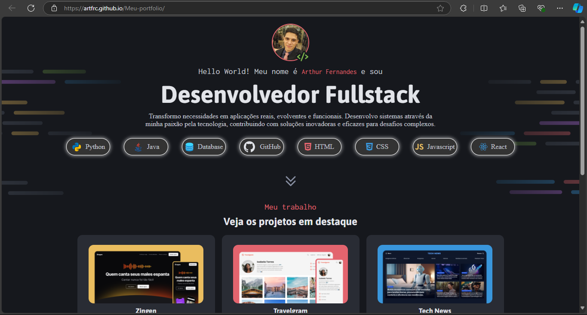

# Arthur Fernandes — Portfólio

<p align="center">
  Site pessoal com meus projetos, serviços e um formulário de contato que
  realmente entrega mensagem: cai num banco, dispara notificação no Telegram
  na hora, e tudo publicado de verdade (não só uma demo local).
</p>

<p align="center">
  <a href="https://artfrc.github.io/Meu-portfolio/"></a>
  
  
  
</p>

<p align="center">
  <a href="#-sobre">Sobre</a> ·
  <a href="#-tecnologias">Tecnologias</a> ·
  <a href="#-estrutura-do-projeto">Estrutura</a> ·
  <a href="#-rodando-localmente">Rodando localmente</a> ·
  <a href="#-deploy">Deploy</a> ·
  <a href="#-contato">Contato</a>
</p>

<br>

<p align="center">
  
</p>

## 🧭 Sobre

Portfólio estático (HTML/CSS/JS puro, sem framework) publicado no
[GitHub Pages](https://artfrc.github.io/Meu-portfolio/), com:

- Apresentação, projetos em destaque e serviços
- Um formulário de contato **funcional de verdade** — não é só um `mailto:`.
  Ele conversa com uma API própria em Java/Spring Boot (pasta [`backend/`](backend/))
  que valida, salva a mensagem num banco e me notifica no Telegram
  instantaneamente

## 🚀 Tecnologias

**Frontend**
- HTML5 semântico + CSS3 (sem framework/build step)
- JavaScript vanilla (`fetch()` para falar com a API de contato)

**Backend** ([`backend/`](backend/) — detalhes completos no
[README dedicado](backend/README.md))
- Java 21 + Spring Boot 3.5
- Spring Data JPA + H2, validação (Bean Validation), rate limiting por IP,
  endpoint admin protegido por API key
- Notificação instantânea via Telegram Bot API
- Documentação interativa via Swagger/OpenAPI
- Testes com JUnit 5, Mockito e `MockMvc`/`MockRestServiceServer`

## 📁 Estrutura do projeto

```
.
├── index.html          Página única do portfólio
├── styles/              CSS organizado por seção (intro, projects, contact...)
├── assets/
│   ├── images/           Fotos, thumbnails dos projetos, preview
│   ├── icons/             Ícones SVG/PNG usados na UI
│   └── js/contact.js      Lógica do formulário de contato (fetch pra API)
├── backend/              API Java/Spring Boot do formulário de contato
│   ├── src/main/...       Código-fonte (contact/, notification/, security/...)
│   ├── Dockerfile         Build multi-stage pro deploy no Render
│   └── README.md          Como rodar, endpoints, deploy, arquitetura
└── render.yaml           Blueprint do Render (infra como código do backend)
```

## 🖥️ Rodando localmente

O site é só HTML/CSS/JS estático — abra `index.html` direto no navegador ou
sirva com qualquer servidor estático:

```bash
python3 -m http.server 5500
# depois acesse http://localhost:5500
```

Por padrão, o formulário de contato já aponta para a API publicada no Render
(`window.PORTFOLIO_API_BASE_URL` em `index.html`), então funciona mesmo
servindo o front localmente. Se preferir rodar o backend na sua máquina
também (pra debugar, testar sem depender da rede, etc.), veja o passo a passo
em [`backend/README.md`](backend/README.md).

## ☁️ Deploy

| Parte     | Onde                                                              | Como                                          |
|-----------|--------------------------------------------------------------------|------------------------------------------------|
| Frontend  | [GitHub Pages](https://artfrc.github.io/Meu-portfolio/)            | Automático a cada push no `main`               |
| Backend   | [Render](https://render.com) (`artfrc-portfolio-backend`)          | Docker, via blueprint (`render.yaml`)          |

Passo a passo completo do deploy do backend (env vars necessárias, blueprint,
limitações do plano free) em [`backend/README.md`](backend/README.md#deploy-no-render).

## 📬 Contato

- [LinkedIn](https://www.linkedin.com/in/fernandes-arthur/)
- [GitHub](https://github.com/artfrc)
- [WhatsApp](https://wa.me/553498324433)
- Ou pelo [formulário no próprio site](https://artfrc.github.io/Meu-portfolio/#contato) 🙂
